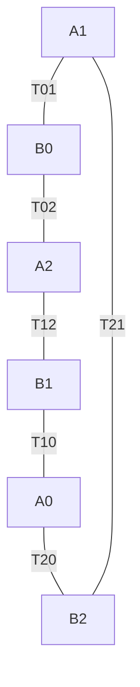

# Coupled endpoints, complete role contacts and the energy they select

**PUBLIC / NON-CANONICAL / L1. Authored analytical results.**
A. M. Thorn. Apache-2.0. Claim #1624.
Contract/source pin: `ecfb13823a43243dbdb09c5d3879d323dc2deea6`.
Exact source custody and inherited scopes: [SOURCES.md](SOURCES.md).

There is a positive connection to the existing program: a word of 39
leaves in the canonical declared affine/CSUM alphabet takes every
nominated X_rho to Y_rho at fixed k=Az. Its entire action is an order-five
translation, and its later states do not conserve either of the source's
two candidate accounts. Thus endpoint reachability is already available
in that alphabet, while the specified full conservative contact is a
different requirement.

The six role-conjugate sparse contacts have an exact common graph.
That graph determines both their actual composed reachability and the
rank of their energy constraints. Any five of the six contacts determine
all six independent positive edge prices up to one unit, in the declared
coordinate-additive family. A different positive pair account survives
all contacts and the same calibration, so physical energy uniqueness
does not follow outside that family.

All coordinates are in F5. Energies, counts, dimensions and word lengths
are ordinary real numbers or integers. All proofs are analytical; no
scientific program or state enumeration was used. Products of maps act
right to left. A fixed word is not identified with the autonomous U.

## 1. Complete carriers and inherited contact

An original checkpoint is x=(a,b,c,d,q,r) in F5^6, with z its coordinate
sum. To avoid ambiguity, a coordinate named a is distinguished from the
generator g_a. The source's prepared chart has

\[
\gamma=(A,z,r)\in\{1,4\}^2\times\mathbb F_5,
\qquad h=(\mu,\lambda)\in\mathbb F_5^2,
\qquad k=Az\in\{1,-1\}.
\tag{1}
\]

The literal inverse chart is

\[
\begin{aligned}
B&=3A,&q&=z-4A-r,\\
C&=k(2+3\mu),&D&=k(1+3\lambda),\\
a&=3(A+C+2),&c&=3(A-C-2),\\
b&=3(B+D+1),&d&=3(B-D-1).
\end{aligned}
\tag{2}
\]

It recovers the source's H={A=2B, B in {2,3}, z in {1,4}}, with
A=a+c, B=b+d, C=a-c-2 and D=b-d-1. H has 500 states. No register
is hidden in this chart. At fixed gamma it is affine in h, and a content
change gives exactly

\[
(\Delta a,\Delta b,\Delta c,\Delta d)
=(-k\Delta\mu,-k\Delta\lambda,
   k\Delta\mu,k\Delta\lambda).
\tag{3}
\]

The prepared three-cell state is (n,gamma,h0,h1,h2), with a shared
original counter and shared gamma. At fixed n there are 20*25^3=312500
checkpoints, including both trace sheets. At fixed n,gamma there are
25^3=15625 independent content triples.

Original common continuation fixes all h_i. It advances n and changes
gamma by (-A,-z,-r) under b or (-A,z,1-r) under the actual d/e choice.
The source's restrictions on the inverse of selected U are unchanged;
no global inverse on the union of trace sheets is assumed.

Put u=(2,0), w=(1,1) and rho=h0. The exact source contact is

\[
T_0:\quad X_\rho=(\rho,\rho+u,\rho)
\longleftrightarrow
Y_\rho=(\rho,\rho+w,\rho+w),
\tag{4}
\]

for every rho, fixing every other content triple and n,gamma. It is a
full involution, deliberately supplied in #1621 and retained in #1623.
Commutation with original continuation follows from its content-only
action and does not establish native occurrence.

For kappa>0 let f_kappa(0)=0, f_kappa(+-1)=1,
f_kappa(+-2)=kappa, and define the source pair and triangle accounts

\[
D_\kappa(h_i,h_j)=2\sum_{l=1}^2f_\kappa(h_{i,l}-h_{j,l}),
\qquad
\mathcal E_{\kappa,\eta}=D_{01}+D_{02}+\eta D_{12},
\quad\eta\ge0.
\tag{5}
\]

Here D_ij means D_kappa(h_i,h_j), including the piston-pair factor two.
The source theorem T0 conserves (5) iff kappa(1+eta)=4 remains correct.
All comparisons below use the same labelled complete states.

## 2. An explicit word in the existing coupled alphabet

### 2.1 The declared alphabet and an extracted translation

KERNEL-CONNECT-ALL-K [T] uses the raw coupled carrier (F5^6)^K, K>=2,
diagonal original letters D_g and complete-cell ring transvections
R_i:x_(i+1)->x_(i+1)+x_i and their reverse orientations. Every q,r
coordinate participates. This is a declared gate alphabet and a
connectivity theorem, with no autonomous selection calendar. Its raw
carrier has no counter n. We use K=3 and indices modulo three.

The three needed original generators are affine involutions:

\[
\begin{aligned}
g_a(x)&=(b,a,d,c,q,r),\\
g_c(x)&=(2-c,1-d+r,2-a,1-b-r,1-q,-r),\\
g_d(x)&=(2-a,1-b,3-c,4-d,1-q,1-r).
\end{aligned}
\tag{6}
\]

Write g_d(x)=v_d-x, where v_d=(2,1,3,4,1,1), and g_g(x)=M_g x+v_g
for an arbitrary affine letter. For t in F5 define

\[
S_i(t)=D_d R_{i-1}^{-t}D_d R_{i-1}^{t}.
\tag{7}
\]

**Translation identity.** S_i(t) adds t*v_d to cell i and fixes all
other complete cells.

**Proof.** Let the source cell be x and the target y. After R^t the
target is y+t*x. After D_d it is v_d-y-t*x, and the source is v_d-x.
After R^(-t) the target is (1-t)*v_d-y. The last D_d makes it
y+t*v_d. The source and every other cell have received two D_d and
return exactly. This proves the identity on the entire raw carrier.
It is the canonical extraction identity with an explicit coefficient.

Conjugation by an affine bijection sends a translation by v to the
translation by M_g v. Direct use of (6) gives

\[
M_a v_d=(1,2,4,3,1,1),\qquad
M_c v_d=(-3,-3,-2,-2,-1,-1),
\]

and consequently

\[
\begin{aligned}
v_d-M_a v_d&=(1,-1,-1,1,0,0),\\
2v_d+2M_a v_d-M_c v_d&=(-1,-1,1,1,0,0).
\end{aligned}
\tag{8}
\]

### 2.2 The complete 39-leaf word

Fix a compilation parameter epsilon in {1,-1}. Define

\[
\boxed{\begin{aligned}
L_\epsilon={}&S_1(\epsilon)S_2(2\epsilon)\,
D_a[S_1(-\epsilon)S_2(2\epsilon)]D_a\\
&{}\cdot D_cS_2(-\epsilon)D_c.
\end{aligned}}
\tag{9}
\]

The un-conjugated factors and the two conjugated blocks are pure
translations and commute. Equations (7)--(8) therefore prove its full
raw action:

\[
\boxed{\begin{aligned}
x_0'&=x_0,\\
x_1'&=x_1+\epsilon(1,-1,-1,1,0,0),\\
x_2'&=x_2+\epsilon(-1,-1,1,1,0,0).
\end{aligned}}
\tag{10}
\]

This is not merely a statement about the nominated two inputs. It is
the exact operator on every raw three-cell checkpoint. It fixes all
q_i,r_i, source sums A_i, receiver sums B_i and z_i at complete-word
boundaries, and fixes the complete reference cell. It is nonzero, so

\[
L_\epsilon^5=I,\qquad L_\epsilon^{-1}=L_{-\epsilon},
\tag{11}
\]

and every raw orbit of this fixed translation has length five.

Each of the five S_i(t) in (9) has t!=0. Expanding R^t and R^(-t)
as positive powers in {1,2,3,4} uses five R leaves in total, plus two
D_d leaves. The five blocks thus use 35 leaves; the two D_a and two
D_c make **39 leaves**. Only D_a,D_c,D_d,R_0,R_1 occur. No claim of
minimum length is made.

On every prepared gamma with actual k=epsilon, (3) turns (10) into

\[
L_\epsilon:\quad
h_0'=h_0,\quad h_1'=h_1+(-1,1),\quad h_2'=h_2+(1,1).
\tag{12}
\]

Hence (9) takes X_rho to Y_rho for every rho on that sector, with all
endpoint controls and the full reference restored. This is a positive
realization of the endpoint family in an already declared canonical
coupling class.

The compilation sign matters. On a prepared sector with k=-epsilon,
the same raw word reverses the content increments in (12). Original
d/e continuation reverses k, so a fixed L_epsilon does not generally
commute with U. Choosing L_(Az) from the current state would be an
additional data-dependent selection rule. It has not been derived.

For any ordered role pair (i,j), i!=j, let l be the remaining cell.
Replace subscripts 1,2 in (9) by j,l. The word then fixes reference i
and applies the two displayed increments to j,l. The existing ring
provides the needed R_(j-1),R_(l-1). Thus every nominated role endpoint
has the same 39-leaf realization; no physical whole-cell relabelling
operation is presumed in this construction.

Intermediate leaves can leave H and the common Gamma carrier. For
example a ring addition applied to common Gamma makes the target
Gamma equal to 2*Gamma, while the source remains Gamma; their nonzero
z values then differ. Endpoint restoration does not price this excursion.
Fixing an appended n is a possible mathematical extension of (9), not
a physical account of the gate word's duration or controller.

## 3. The complete five-cycle prevents an endpoint-only energy claim

From (12), at fixed actual k=epsilon,

\[
L_\epsilon^t X_\rho:
\quad h_0=\rho,\quad
h_1=\rho+(2-t,t),\quad h_2=\rho+(t,t),
\quad t\in\mathbb F_5.
\tag{13}
\]

In particular h1-h2=(2-2t,0). Substituting in (5) gives

\[
\mathcal E_t=2\{f_\kappa(2-t)+3f_\kappa(t)
                       +\eta f_\kappa(2-2t)\}.
\tag{14}
\]

This gives every state and account on the complete cycle:

| t | E_(kappa,eta) | Square star (4,0) | Equal triangle (2,1) |
| ---: | --- | ---: | ---: |
| 0 | 2 kappa(1+eta) | 8 | 8 |
| 1 | 8 | 8 | 8 |
| 2 | 2 kappa(3+eta) | 24 | 16 |
| 3 | 2(1+3 kappa+eta) | 26 | 16 |
| 4 | 2(kappa+3+eta) | 14 | 12 |
| 5, returning to 0 | 2 kappa(1+eta) | 8 | 8 |

The first transition conserves the account exactly under #1623's
condition kappa(1+eta)=4. The whole cycle cannot conserve any member
of (5), because

\[
\boxed{\mathcal E_2-\mathcal E_0=4\kappa>0.}
\tag{15}
\]

In particular L_epsilon does not implement the full conservative T0:
it has order five, changes every raw checkpoint, and does not send Y
back to X on its next forward use. Its existence nevertheless shows
that a claim of endpoint impossibility for the entire declared CSUM
alphabet would be false.

If an additional independently priced bank B is required to conserve
E+B, its changes at the five successive macro boundaries must be:

| Fixed account | Delta B on 0->1,1->2,2->3,3->4,4->0 |
| --- | --- |
| Square star (4,0) | 0, -16, -2, +12, +6 |
| Equal triangle (2,1) | 0, -8, 0, +4, +4 |

Starting at t=0, nonnegativity of such a bank at these boundaries
would require B0>=18 for the star and B0>=8 for the triangle. These
bounds are sharp for the displayed numerical boundary balances: choose
B_t=B0+E0-E_t. They do not construct an independently priced bank,
its update or its funding through the 39 internal leaves. They cannot
be called physical minimum preparation costs.

For the square triangle (4,1), the same formula gives
16,8,32,28,16. Its first branch requires the bank to receive +8,
exactly as in #1623. Later branches have their own balance obligations.
All cycle differences telescope to zero; no cycle-integrability failure
is asserted. Defining a compensating price after choosing E would not
select that E independently.

## 4. Three distinct implementation boundaries

### 4.1 Common original letters do not realize the endpoint

For common Gamma=(z,q,r), every simultaneous original letter preserves
that equality across cells. On each piston difference
delta=(delta_a,delta_b,delta_c,delta_d), the literal actions are

| Letter | New difference |
| --- | --- |
| a | (delta_b,delta_a,delta_d,delta_c) |
| b or c | (-delta_c,-delta_d,-delta_a,-delta_b) |
| d or e | -delta |

These source formulas follow by subtracting the affine original
generators; the r terms in c cancel because Gamma is common. Thus
N_s^(ij), the number of pairwise piston differences of magnitude s,
s=1,2, is preserved separately for every pair. Whole-cell permutations
relabel the pairs and preserve

\[
M_s=\sum_{i<j}N_s^{ij},\qquad s=1,2.
\tag{16}
\]

The conclusion holds for any number of successive allowed moves,
including state-dependent choices and intermediate states outside H.
Here there are exactly the three target cells, with no hidden auxiliary
cross-edge account. On (4), equation (3) gives

\[
X_\rho:(M_1,M_2)=(0,4),\qquad
Y_\rho:(M_1,M_2)=(8,0).
\]

Consequently this smaller common-letter/permutation class cannot take
X to Y. It does not contain CSUM, which can break common Gamma, or
independent local W. Original prepared U is still more restricted:
it fixes all contents and cannot perform any changed role branch.

### 4.2 A fixed affine word cannot implement the sparse contact

Fix gamma and the retained reference rho. The two signal contents
form F5^4. The exact T0 transposes two of its 625 points and fixes
the other 623. A fixed word of original affine letters, whole-cell
linear additions and affine permutations is affine on the raw carrier.
If it realizes the target on every point of this prepared layer, the
input chart, output projection and fixed-gamma inverse chart imply
an affine signal map on F5^4.

An affine map F(v)=Mv+b has fixed set (M-I)v=-b, either empty or an
affine subspace. Unless F is the identity, that set has at most
5^3=125 points. It cannot have exactly 623. Identity cannot exchange
the two nominated points. This excludes the entire sparse T0 and,
by relabelling its retained reference, each T_ij.

The argument also covers any fixed affine auxiliary preparation as a
function of the input contents, followed by a fixed affine full word
and affine raw output projection. Their composition is still affine;
the auxiliaries need not be restored for this particular obstruction.
Nonlinear preparation, a data-dependent word or a differently typed
nonlinear output reading changes the hypothesis.

### 4.3 No alternative affine conservative endpoint map in the stated class

There is a stronger energy obstruction for the source account, distinct
from its sparse fixed-point requirement.

**Theorem.** Fix gamma,rho and kappa>0, kappa!=1, eta>=0. No affine
map of all signal contents F5^4 can preserve E_(kappa,eta) on every
input and take X_rho to Y_rho while retaining that reference and context.

**Proof.** Center contents at (rho,rho). The two positive star terms
make zero the unique zero-price vector. A price-preserving affine
map must fix it, so its centered map F is linear and F(2v)=2F(v).
Let P_s=N_s^(01)+N_s^(02)+eta*N_s^(12), s=1,2. These are weighted
ordinary counts, with the raw piston multiplicities from (3).
Doubling every centered content exchanges the magnitude classes:
P1(2v)=P2(v), P2(2v)=P1(v). Conservation at v and 2v gives

\[
\Delta P_1+\kappa\Delta P_2=0,\qquad
\Delta P_2+\kappa\Delta P_1=0.
\tag{17}
\]

Since kappa>0 and kappa!=1, both differences vanish. But X to Y
has Delta P1=8. This is a contradiction. QED.

The theorem includes the star (4,0) and triangle (2,1). It does not
assert the kappa=1 case, a changing reference/store, or a map whose
endpoint domain is not this whole prepared layer. Thus the failure
of (9) cannot be repaired simply by choosing another fixed affine
word that globally conserves the same account on that layer.

## 5. The full role-contact graph

For j=0,1,2 define A_j(rho) to have one cell j at rho+u and the
other two at rho. Define B_i(rho) to have cell i at rho and the
other two at rho+w. Supply the six maps

\[
\boxed{T_{ij}:A_j(\rho)\longleftrightarrow B_i(\rho),
\qquad i\ne j,}
\tag{18}
\]

for all rho, fixing every other triple and n,gamma. They are exactly
the role conjugates of (4). T0=T_01; the second source contact is
T1=T_10. Conjugacy is a mathematical description of these full maps,
not a claim that a relabelling gate or the contacts occur under U.

### 5.1 Disjointness and complete reachability

All A_j(rho) are distinct: the repeated value gives rho and the unique
deviation gives j. The same holds for B_i, whose minority gives rho
and i. If A_j(rho)=B_i(sigma), then the repeated and unique values
would satisfy rho=sigma+w and rho+u=sigma, forcing u=-w. This is
false for (2,0) and (1,1). Therefore the 25 six-element sets

\[
\mathcal O_\rho=\{A_0(\rho),A_1(\rho),A_2(\rho),
                    B_0(\rho),B_1(\rho),B_2(\rho)\}
\tag{19}
\]

are pairwise disjoint. The contact graph on each is the cycle

\[
A_1-B_0-A_2-B_1-A_0-B_2-A_1,
\tag{20}
\]

whose edge labels in that order are 01,02,12,10,20,21. It is
K_(3,3) with the three i=j edges deleted. All other 15625-150=15475
content triples are fixed by every role contact.

Nodes denote complete content triples at one fixed rho, not positions
in physical space or separately assumed interacting cell pairs.

Transpositions along the edges of a connected finite graph generate
all permutations of its vertices. For completeness, conjugating an
edge transposition successively along a simple path produces the
transposition of the path's first vertex with each next vertex; these
star transpositions generate the full symmetric group. For a graph
with several components, supports are disjoint and the component
symmetric groups form a direct product.

Apply this to any selected subset of the six role edges. The same word
acts by the same vertex permutation in every O_rho. Hence all six
generate a **diagonal S6**, not a product S6^25; a subfamily generates
the corresponding product of component symmetric groups, likewise
diagonally repeated over rho. No independent control for individual
rho was supplied. Any five edges form a path through all six vertices,
so they already generate the same S6. Fewer than five cannot connect
all six vertices.

### 5.2 The two source equations do not imply composed transport

T_01 exchanges A1,B0, whereas T_10 exchanges A0,B1. Their supports
are disjoint over all rho. Therefore

\[
T_{01}T_{10}=T_{10}T_{01},\qquad
\langle T_{01},T_{10}\rangle\cong C_2\times C_2.
\tag{21}
\]

Every nontrivial orbit of this pair has only two points. After one
changes a state, the other fixes the result. Two independent energy
equations in #1623 therefore do not by themselves create a longer
transport path. This is consistent with their conditional price
selection.

### 5.3 All content invariants and a same-energy obstruction

A real content function is conserved by a family of bijections iff
it is constant on every orbit. For s distinct role contacts with
0<=s<=5, the graph is a forest with 6-s components. At s=6 it has
one component. Thus there are exactly

\[
\boxed{15625-25\min(s,5)}
\tag{22}
\]

independent real content invariants at fixed n,gamma. This is the
dimension of their vector space, including constant functions. In
particular the dimensions for just T0, for T0,T1, and for all roles
are 15600, 15575, and 15500. Content-only functions of this kind
also survive original common U, since U fixes every content.

All six active states in each O_rho have E_(2,1)=8. But the state
Z=(0,u,u) has the same energy 8 and is fixed by every role contact.
Its repeated value is u and its deviation is -u, so it is no A_j;
its difference from minority to majority is u!=w, so it is no B_i.
Equal triangle energy therefore does not imply shared reachability,
even after all role contacts have been supplied.

## 6. Exact transport in the supplied contact family

A different pair of contacts genuinely composes:

\[
A_1(\rho)\xrightarrow{T_{01}}B_0(\rho)
\xrightarrow{T_{02}}A_2(\rho).
\tag{23}
\]

The fixed product T_02 T_01 is a three-cycle on these states. It
moves the prepared deviation u from cell 1 to cell 2 and restores
cell 1 to rho. Both contacts have the same retained reference 0 and
preserve the original square-star account (4,0). Thus this transport
does not itself select the triangle account.

Complete repeated routing can also preserve the A/B shape at every
macro boundary. Let

\[
R_{12}=T_{01}T_{02}T_{01},\quad
R_{02}=T_{10}T_{12}T_{10},\quad F_A=R_{12}R_{02}.
\tag{24}
\]

The conjugated transpositions R12 and R02 swap A1,A2 and A0,A2,
respectively, fixing all B states and every other triple. Therefore
F_A maps A0->A1->A2->A0 for each rho, fixes everything else, and
F_A^3=I on the whole content carrier. This is a fixed six-contact
word, not a state-dependent schedule. Since u=(2,0), its boundary
transport moves only the source content mu; all lambda values on
these boundaries remain rho_lambda.

For a boundary change of actual completed receiver contents, define

\[
Q_{12}=T_{10}T_{20}T_{10},\quad
Q_{02}=T_{01}T_{21}T_{01},\quad F_B=Q_{12}Q_{02}.
\tag{25}
\]

These swap B1,B2 and B0,B2. Hence F_B sends B0->B1->B2->B0,
fixes all other triples, and has cube I. It moves the position of
the cell left at rho among two cells at rho+w, changing the present
lambda readings at the affected cells. Both full words preserve the
equal-triangle account. They only circulate their prepared six-state
patterns; they do not load arbitrary independent new messages.

Every fixed role word is a permutation within each six-element orbit,
so an individual content orbit has period at most six. An externally
varying word has not been made autonomous by this fact. Appending U
advances the native counter and controllers: a content return is not
a return of the complete native state. Preparations, gate occurrence
and independent message supply remain separate requirements.

## 7. Six independent edge prices: a complete classification

### 7.1 The reading family and its endpoint coordinates

Do not assume equal cell-pair weights or a common double/unit ratio.
For each edge e in {01,02,12}, independently choose

\[
f_e(0)=0,\qquad f_e(\pm1)=\alpha_e>0,\qquad
f_e(\pm2)=\beta_e>0,
\]

and use this same f_e on the two content coordinates of that edge:

\[
\boxed{\mathcal E=2\sum_{e=\{i,j\}}\sum_{l=1}^2
                          f_e(h_{i,l}-h_{j,l}).}
\tag{26}
\]

This is a six-parameter family of complete prepared-state readings.
Coordinate additivity and equal treatment of the two coordinates are
explicit assumptions. We prove a selection theorem within this family,
not that physics must choose the family.

Introduce real incident-price sums

\[
a_i=\sum_{e\ni i}\alpha_e,\qquad
b_i=\sum_{e\ni i}\beta_e,\qquad y_i=b_i/2.
\tag{27}
\]

These lower-case a_i are real price sums, not the F5 piston a or
the prepared A_i state label. At the six active endpoints,

\[
\mathcal E(A_j(\rho))=2b_j=4y_j,\qquad
\mathcal E(B_i(\rho))=4a_i.
\tag{28}
\]

The first formula has two incident differences u, each costing
2*beta_e. The second has two incident differences w, each costing
4*alpha_e. All fixed contact branches add no constraint. Thus

\[
\boxed{T_{ij}\text{ conserves }\mathcal E
\quad\Longleftrightarrow\quad a_i=y_j.}
\tag{29}
\]

The parameter change (27) is invertible. With {i,j,l}={0,1,2},

\[
\alpha_{ij}=\frac{a_i+a_j-a_l}{2},\qquad
\beta_{ij}=y_i+y_j-y_l.
\tag{30}
\]

Different parameters also give different functions on the complete
carrier: the six values in (28) recover all a_i,y_j and then (30)
recovers all six prices. This is not a redundancy of notation.

### 7.2 The same graph fixes the energy and the reachable states

Equation (29) puts an equality on the edge B_i--A_j of precisely
the contact graph (20). On each connected component, all its endpoint
energy coordinates must be equal. Conversely such equalities conserve
every chosen contact on every state.

For s different roles, the rank of these real linear equations is
min(s,5): a proper subgraph of the six-cycle is a forest, and the sixth
edge gives the single redundant cycle equality. Invertibility of (30)
therefore yields

\[
\boxed{\dim\mathcal C_s=6-\min(s,5),}
\tag{31}
\]

where C_s is the solution space before positivity and unit fixing.
The strictly positive portion has the same dimension. To see this,
alpha_e=1,beta_e=2 is an interior solution for every selected subset,
with all a_i=y_i=2. Assign independent sufficiently small changes to
the constants on the graph components; formula (30) keeps every
price positive. Thus no missing equation is supplied merely by
requiring positive energy.

Use the same calibration as #1623,

\[
h_0=0,\quad h_1=h_2=e_1=(1,0),\qquad
\mathcal E=2a_0=4.
\tag{32}
\]

It sets a0=2, removing one component constant. The exact remaining
dimension is 5-min(s,5).

| Distinct role contacts s | Rank | Dimension before unit | Dimension after (32) |
| ---: | ---: | ---: | ---: |
| 0 | 0 | 6 | 5 |
| 1 | 1 | 5 | 4 |
| 2 | 2 | 4 | 3 |
| 3 | 3 | 3 | 2 |
| 4 | 4 | 2 | 1 |
| 5 | 5 | 1 | 0 |
| 6 | 5 | 1 | 0 |

Any five distinct roles connect every endpoint. Hence a_i=y_j=t
for all indices, and (30) gives alpha_e=t/2,beta_e=t. Calibration
sets t=2. We have proved the sharp full-carrier statement

\[
\boxed{\begin{gathered}
\text{Any five of the six roles select, in (26),}\\
\alpha_{01}=\alpha_{02}=\alpha_{12}=1,\qquad
\beta_{01}=\beta_{02}=\beta_{12}=2.
\end{gathered}}
\tag{33}
\]

Fewer than five leave a positive family after the same calibration.
This is simultaneously the sharp number of these role edges needed
to connect the six active states. It is not a minimum number of
physical interactions, gate leaves or microsteps. Nor does it derive
that the three energy-bearing cell pairs occur in the native apparatus.

### 7.3 A calibrated four-contact counterfamily

Admit T_01,T_02,T_10,T_12. They include both contacts of #1623.
For any real t with -2<t<2, let

\[
\alpha_{01}=1-t/2,\qquad
\alpha_{02}=\alpha_{12}=1+t/2,\qquad
\beta_{01}=\beta_{02}=\beta_{12}=2.
\tag{34}
\]

Then a0=a1=2, a2=2+t and y0=y1=y2=2. All four required equalities
(29) hold, and the calibration (32) is unchanged. At t=1 the three
double/unit ratios are 4,4/3,4/3, so this ambiguity cannot be a common
rescaling. Either remaining role, T_20 or T_21, forces a2=2 and hence
t=0. This is a concrete witness to the general sharp bound.

## 8. Why the answer depends on the declared price family

### 8.1 A common ratio with freely weighted edges needs three roles

In the subfamily beta_e=kappa*alpha_e, kappa>0, (29) becomes

\[
\kappa a_j=2a_i,\qquad i\ne j.
\tag{35}
\]

For T_01 and T_10, these imply kappa^2=4. Positivity yields
kappa=2 and a0=a1, equivalent to alpha_02=alpha_12. Alpha_01 is
still free before further constraints, including a positive freedom
after a single calibration.

**Three-role theorem.** Any three distinct role contacts in this
common-ratio family force kappa=2 and all three edge weights equal.

**Proof.** If the three directed pairs contain an opposite pair,
the preceding argument gives kappa=2. Their underlying graph connects
all three cell indices, so (35) then makes all a_i equal. If there is
no opposite pair, the three roles orient the three edges of a triangle.
Follow that triangle once and multiply the ratios a_i/a_j supplied by
(35), reversing a ratio when traversing an edge backwards. This gives
(kappa/2)^r=1, with r one of -3,-1,1,3. Positivity again forces
kappa=2. All a_i are equal and (30) gives equal alpha_e. QED.

Three is sharp. With two opposite roles, kappa=2 and equality of two
a_i leave the third free near the positive equal-weight point. With
two nonopposite roles, their underlying graph is a two-edge tree:
choose kappa near 2, propagate a_i/a_j=kappa/2 along the tree and
use a common scale to enforce a0=2. Formula (30) stays positive for
a sufficiently small change. Both cases retain inequivalent calibrated
accounts.

In the smaller #1623 family, alpha_01=alpha_02=1 and alpha_12=eta
were already fixed in that form. Its nominated T_01,T_10 therefore
give kappa(1+eta)=4 and kappa=1+eta, selecting (2,1). That result
is correct, including its eta=0 comparison, but it cannot be applied
to a larger price family without additional equations. The sharp
hierarchy of the stated families is thus:

| Frozen comparison family | Sufficient and sharp role count |
| --- | --- |
| #1623's kappa,eta family | The nominated two contacts |
| One common kappa, three free positive edge weights, one calibration | Any three distinct roles |
| Six independent positive coordinate prices, one calibration | Any five distinct roles |

### 8.2 Even a symmetric pair account need not be coordinate-additive

Let g:F5^2->R be any even function with g(0)=0 and define

\[
E_g=\sum_{i<j}g(h_i-h_j).
\tag{36}
\]

At A_j the value is 2g(u); at B_i it is 2g(w). Thus every nonempty
role family conserves (36) on the entire content carrier iff

\[
\boxed{g(u)=g(w).}
\tag{37}
\]

There are twelve independent nonzero values for an even g, since the
24 nonzero vectors form twelve pairs {v,-v}. The classes of u and w
are distinct, so (37) removes just one dimension. This is a broader
declared comparison, not a classification of all physical energies.

An explicit positive alternative to the selected account (33) is

\[
\boxed{E_{\rm disc}=2\,\#\{\{i,j\}:h_i\ne h_j\}.}
\tag{38}
\]

It uses g(v)=2 for v!=0. It is nonnegative, vanishes exactly when all
three contents agree, and is invariant under cell permutations, common
content translations and simultaneous interchange of mu and lambda.
Every active A or B has exactly two unequal pairs, so all six contacts
conserve it. Original U fixes contents and also preserves it.

| Complete content state | Selected equal-triangle account | E_disc |
| --- | ---: | ---: |
| (0,e1,e1), common calibration | 4 | 4 |
| Any A_j(0) or B_i(0) | 8 | 4 |

The functions are inequivalent on the same labelled carrier after the
same calibration. E_disc is a sum of common pair prices, but it is not
additive over the two content coordinates: g(1,1)=2, while
g(1,0)+g(0,1)=4. Thus the selection theorem for (26) retains a real
family hypothesis even after all roles and the listed symmetries are
imposed. This does not contradict #1623's common single-cell-price
obstruction: (38) is an interaction account, not a sum of one common
price h(h1)+h(h2) with a fixed reference contribution.

## 9. Synthesis with the existing program

The results distinguish three already named kinds of dynamical input.

| Input | Exact consequence here | Remaining requirement |
| --- | --- | --- |
| Literal common prepared U | Every h_i stays fixed | A changed contact is not its later iterate |
| Declared affine letters and CSUM ring | The explicit 39-leaf word realizes every fixed-sign role endpoint | A full conservative contact, its selection, and a microscopic account |
| Supplied role-contact involutions T_ij | Exact finite graph, composed transport and conditional price classification | Independent admission/occurrence, preparations and complete physical reading class |

The first and second rows must not be conflated. KERNEL-CONNECT-ALL-K
already proves that the declared coupled group contains all raw
translations. Indeed a raw-cell state function invariant under every
freely available generator in that alphabet would be constant: for
any x,y, the translation by y-x belongs to the group and takes one
to the other. The theorem provides controllable connectivity. It does
not say that every such command is an unpriced step of one closed
conservative apparatus. A nonconstant complete energy requires a more
restricted actual law or independently accounted changing resources.

Canon v103 also contains a genuinely nonlinear supplied-gate comparison.
DEF-RESIDUAL-CONTACT-ARCHITECTURE uses
X=F5^12 x {0,1}, with the declared W_a,W_b controls driven by an
input mixed Gram reading and a real retained bit. Its compiler
ALGEBRAIC-RESIDUAL-REALIZATION acts by even permutations on a factor
F=F5^10 x {0,1}, with an accompanying exact q action H_f in GL2(F5).
The factor theorem does not justify setting that q action to identity.
RESIDUAL-STEP-RECORD adds
the specified q-to-r reading couplings and composes the full law
V=A_y T_alg A_x on its own carrier.

Those theorems already provide a constructive route beyond affine
words in their declared architecture. The Canon explicitly treats
the W controls and reading couplings as supplied interfaces, not as
words derived from autonomous U or J. Their factor result does not
by itself compile a permutation on this note's three-cell carrier
with its actual reference and complete energy. A future use here
must provide that exact carrier/interface translation, including the
accompanying q action and every changing resource. The present affine
obstructions do not exclude that separate nonlinear route.

This keeps the current program boundary concrete. We now have a
canonical-alphabet word reaching the desired prepared endpoints;
we know its entire raw action and endpoint energy cycle; we know
exactly which supplied role compositions connect the sparse contacts;
and we know how those contacts select, or fail to select, the stated
energy families. A further physical claim must put the selected
conservative law, its occurrence and all priced changing parts on
one complete apparatus. The word, contact graph and candidate energy
cannot be identified after the fact merely because they share an
endpoint.

Nothing here maps h=(mu,lambda) to the Dirac/Floquet labels of #1605,
or supplies the particle-bank conversion left untyped in #1596.
The finite m/arctan(m)>1 statement for m>0 retains its existing
scope; no cost-of-existence or entropy interpretation follows from
the finite accounts above. Counts such as 8,18 or 39 are not identified
with the separate working-machine payment 10 or the gap
2*sqrt(1+m^2)-2m. No Canon status, physical apparatus owner, layer
gate, occurrence law or native-admission conclusion is promoted.
